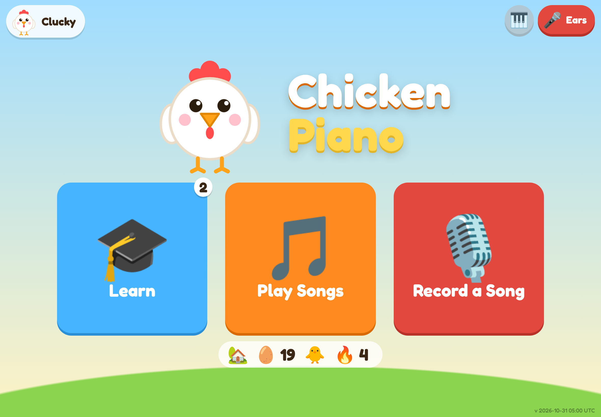
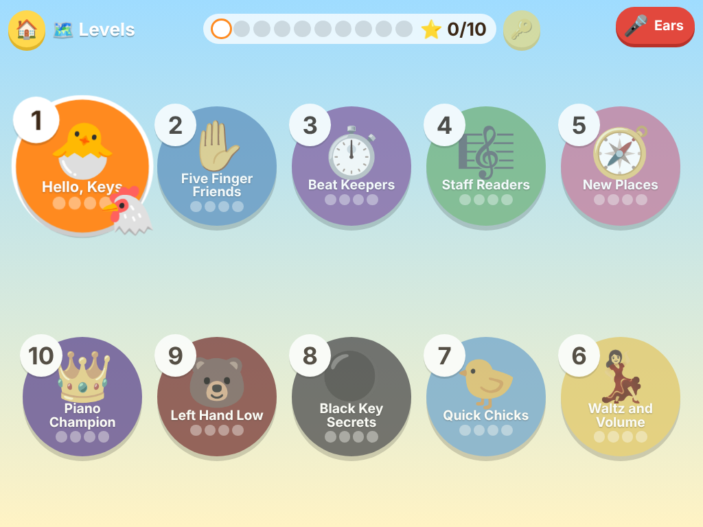
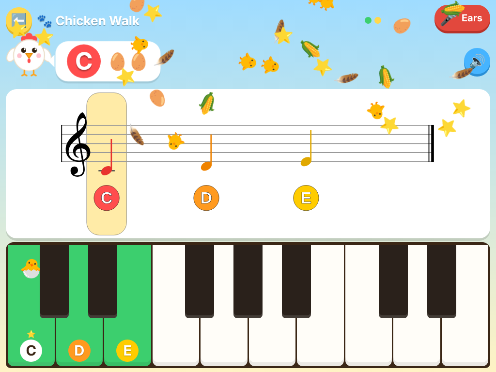

# Chicken Piano 🐔🎹

**A free, friendly piano teacher for kids, with a chicken in charge.**

### ▶️ Play now: **[chicken-piano.vercel.app](https://chicken-piano.vercel.app)**

No download, no sign-up, no ads. Open it in a browser, prop your tablet on the piano like sheet music, and start playing.

<p align="center">
  
  
  
</p>

---

## Why Chicken Piano?

Chicken Piano started as a dad project. My 8-year-old wanted to learn piano, he loves chickens, and his 6-year-old brother wanted in too. Most piano apps are either too wordy for little kids, cost a monthly subscription, or don't actually listen to the piano. So we built the one we wanted: a cheerful chicken who teaches real piano skills, hears what you play, and cheers when you get it right.

## What it does

🎤 **It listens.** Play your real piano or keyboard and Chicken Piano hears each note through the microphone. Right note? The chicken moves on. Wrong note? A gentle nudge to try again.

🎼 **Real music, not just colored blocks.** Every song is shown as proper sheet music on a staff, with an on-screen keyboard right below that lights up the key to press. Kids learn to read notes without even noticing.

🗺️ **10 levels, 40 bite-sized lessons.** Start by finding middle C and work all the way up to finger numbers, note lengths and rests, reading the staff, waltz time, eighth notes, sharps and flats, the bass clef, scales and chords. Each lesson is hands-on: you learn it by playing it.

🎶 **101 songs to play, easiest first in every level.** Favorites get a chicken makeover: *Scrambled Eggs* (Hot Cross Buns), *Twinkle Little Chick*, *Jingle Clucks*, *Happy Hens* (Ode to Joy), *The Coop Is Falling Down* (London Bridge), *Happy Hatch Day* and lots more. The original name is always shown underneath, so grown-ups know the tune.

🥚 **Eggs and chicks to collect.** Finish a lesson, earn an egg. Play a song well, earn up to three. Complete a whole level and a chick hatches into your coop.

🗣️ **A warm, friendly voice.** The chicken talks kids through every step, so there's almost nothing to read. Big buttons, bright pictures and sounds make it work for pre-readers too.

🥁 **Play with the beat.** Tap the drum and the chicken pecks out a gentle metronome, counts you in, and the song moves along in time. Every note is scored for the right key *and* the right moment. (The peck is a tiny high "tick" the microphone knows to ignore, so it never gets mistaken for a piano note.)

🦜 **Echo mode.** The chicken plays a short phrase, you play it back by ear, then the next one. Great for little ones who don't read notes yet.

🐇 🐢 🐌 **Slow it down.** Play songs at full, three-quarter or half speed: Listen, play-with-the-beat and echo all follow it.

🎹 **Free Play.** Just want to noodle around? Free Play shows the name and the spot on the staff of anything you play, and how long you held it. Tap 🥁 for a metronome.

🎙️ **Record and share.** Tap the big 🔴 in Free Play or a song, then find it under 🎙️ Mine. Play it back with the keys lighting up, or tap 📤 to send it to Grandma as a sound file played on the app's own piano (🎬 makes a video of the keyboard instead).

🐔 **A chicken for every kid.** Each child picks their own colored chicken (and a name, if they like) and keeps their own eggs, chicks and open songs. Tap the chicken at the top left of the home screen to switch players.

📲 **Works like an app, even offline.** On an iPad, open the site in Safari, tap Share, then **Add to Home Screen**. It opens full screen, and after the first visit on wifi it works without internet. New versions load automatically the next time it opens online.

👆 **Practice at your own pace.** Any level can be picked at any time, and tapping a note in the music jumps right back to it for another try.

## 🎹 Got a keyboard with USB? Plug it in!

Many digital keyboards (Casio, Yamaha, Roland and others) have a **USB "to host" port** that sends notes digitally. Chicken Piano can read those notes directly. It's faster and more accurate than the microphone, and it works even in a noisy room or with headphones on.

When a keyboard is connected, the **🎹 button turns green** and Chicken Piano listens to the keyboard instead of the mic.

| Device | How to connect |
| --- | --- |
| **Laptop or desktop** (Windows, Mac, Linux) | Plug the keyboard in with a USB cable and open the site in **Chrome, Edge or Firefox**. |
| **Android tablet or phone, Chromebook** | Use a USB cable (or USB-C adapter) and open the site in **Chrome**. |
| **iPad or iPhone** | Safari doesn't support MIDI keyboards yet. Install the free **[MIDIWeb Browser](https://apps.apple.com/app/id6757226617)** app, open **chicken-piano.vercel.app** inside it, and connect the keyboard with a USB-C cable (or Apple's Lightning to USB Camera Adapter on older iPads). |

No USB port on your keyboard? No problem: the microphone works with any piano, acoustic or electric.

## Tips for grown-ups

- **Landscape works best.** Stand the tablet or phone on the music rest, sideways.
- **Tap the 🐣 egg** on the first screen to wake up the chicken (this also lets the browser use sound and the mic).
- **Allow the microphone** when asked. Chicken Piano only listens for notes, right on the device; no audio is ever uploaded.
- **Turn the volume up** so kids can hear the chicken's instructions.
- Progress is saved on the device, so each tablet keeps its own coop. On an iPad, the home-screen app and the Safari tab keep separate coops, so pick one.

---

## Run it yourself / contributing

Chicken Piano is open source under the [MIT license](LICENSE). Suggestions, songs and fixes are welcome: open an issue or a pull request.

```
npm install
node build.mjs     # writes dist/index.html (one self-contained file) plus voice clips in dist/voice
```

The microphone needs HTTPS. The live site is hosted on Vercel, which publishes the committed `dist/` folder as-is (see `vercel.json`; no build step runs there), so run `node build.mjs` and commit `dist/` after changes. On a laptop, the keys A through ; play notes too.

<details>
<summary><b>Regenerating the chicken's voice</b></summary>

Spoken lines are pre-recorded with [Kokoro-82M](https://github.com/hexgrad/kokoro) (open source neural TTS, voice
`af_heart`, runs locally with no API key) into small mp3 clips in `dist/voice/`, named by a hash of the sentence.
The app plays the clip for a sentence when it has one and falls back to the device's built-in speech otherwise.

After changing anything the chicken says (lesson `say`/`hint` text, songs, or the templates in `src/lines.js`):

```
mkdir -p build && pip install -r tools/voice/requirements.txt   # once; needs ffmpeg too
npm run voice      # records only new or changed lines, deletes unused clips
node build.mjs
```

The first run downloads the model (~350 MB) into `~/.cache/chicken-piano-voice`. If a word comes out wrong,
add a regex spelling fix to `tools/voice/pronounce.json` (it changes what the voice reads, not what the app shows).
</details>

## Testing record and share

`node test/recorder.mjs` checks the recording logic offline (timing, mic notes, notation, storage, wav).
`node test/record.cjs [shotsDir]` records, plays back, renders, shares, films and deletes in headless Chromium (after `node build.mjs`).

## Home-screen icons

`node tools/icons.cjs` redraws `dist/icons` from the chicken in `src/chicken.js` (needs Playwright's Chromium).
`node build.mjs` writes `dist/manifest.webmanifest` and `dist/sw.js` (stamped with the build time).
`test/profiles.cjs` and `test/offline.cjs` check players and the offline cache.

<details>
<summary><b>Testing note detection</b></summary>

`test/octaves.mjs` and `test/sequence.mjs` run the note listener offline against every piano sample
(C1–C8) and against overlapping note sequences, with optional tablet-mic effects (quiet, noisy, echoey, weak bass):

```
mkdir -p /tmp/pcm && for f in node_modules/tonejs-instrument-piano-mp3/*.mp3; do
  ffmpeg -loglevel error -y -i $f -t 2 -ac 1 -ar 48000 -f f32le /tmp/pcm/$(basename $f .mp3).f32; done
EXPECT=0 GAIN=0.05 NOISE=0.004 HPF=250 REVERB=0.6 node test/octaves.mjs /tmp/pcm
OVERLAP=0.25 node test/sequence.mjs /tmp/pcm
node test/metronome.mjs /tmp/pcm   # the metronome's peck must not change what is heard
```

The metronome tick is a "peck": a 30 ms burst of hiss above 5 kHz (`src/beat.js`), well above every piano note
the songs use. The app tells the listener when each peck plays; while one is in the listener's window it ignores
loudness jumps and the hiss and only looks for a key strike below 2.5 kHz, so keys played on the beat still count.
`test/metronome.mjs` plays the test tunes on the beat with a peck on every beat (as loud as the piano and 3x
louder, 0–100 ms speaker delay) and checks the listener hears exactly the same notes as without it.
`test/practice.cjs` plays through play-with-the-beat, echo and the speed button in a headless browser.
</details>

### Credits

Built on great open source work:
[Tone.js](https://tonejs.github.io/) (sound),
[VexFlow](https://www.vexflow.com/) (sheet music),
[Pitchy](https://github.com/ianprime0509/pitchy) (pitch detection),
[Kokoro](https://github.com/hexgrad/kokoro) (the chicken's voice),
and piano samples from [tonejs-instruments](https://github.com/nbrosowsky/tonejs-instruments) by Versilian Studios (CC BY 3.0).
Full details in [THIRD_PARTY_NOTICES.md](THIRD_PARTY_NOTICES.md).
